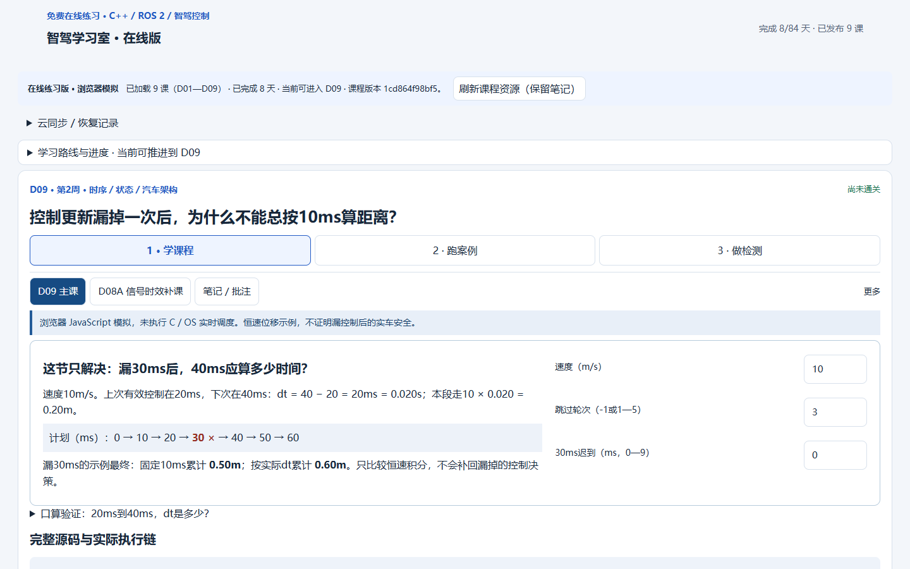
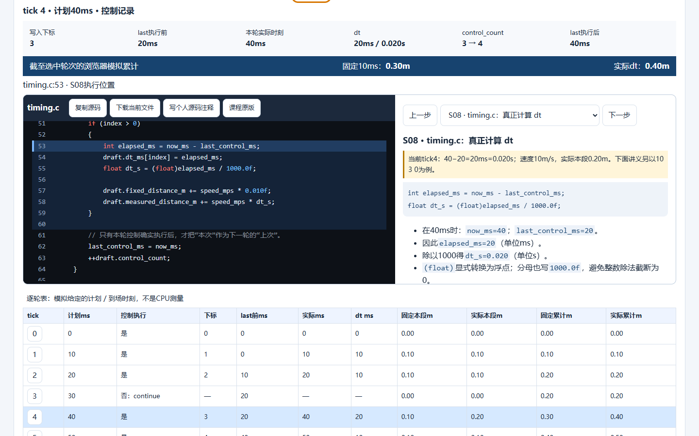
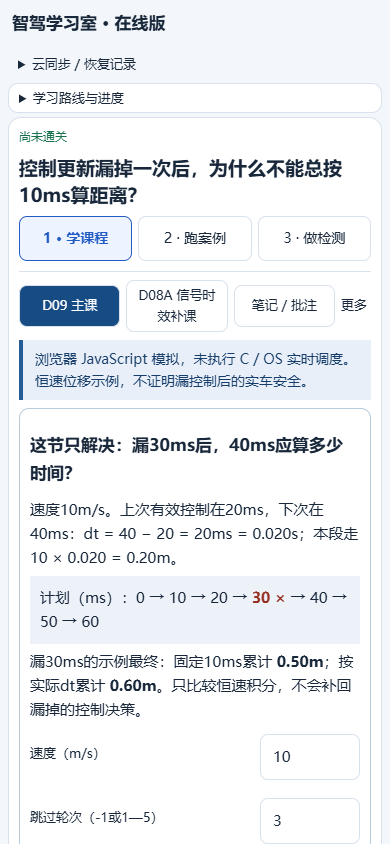
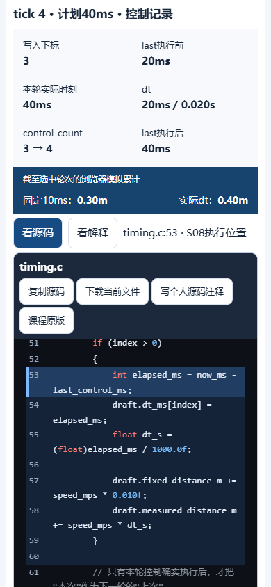
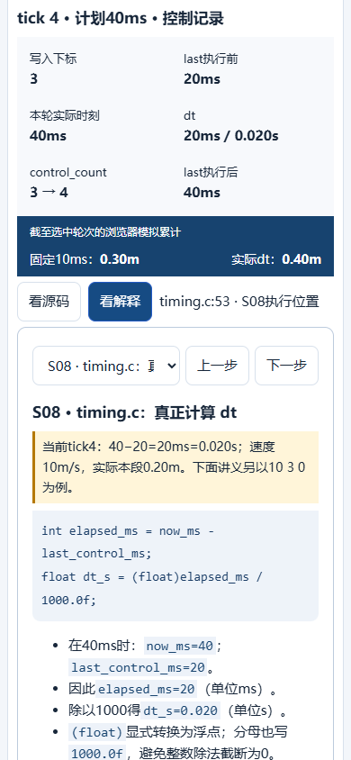

# Day09 v2：待审核实现与真实执行证据

实现依据：[审查/设计](../../docs/day09-v2/00_AUDIT_AND_DESIGN.md)、[完整讲义](../../docs/day09-v2/01_DAY09_LESSON.md)、[工程验收要求](../../docs/day09-v2/02_CODEX_TASK.md)。原设计PR为 #1；本实现使用独立分支 `feat/day09-v2`，不合并main，不部署Pages。

## 状态

| 项目 | 状态 | 实际证据 |
|---|---|---|
| 教学交互实现 | CODING_COMPLETE | 三输入、11步、19个来源、逐轮表与指针写回链、独立D08A |
| C工程验证 | C_TEST_PASS | [完整命令/输出/退出码](c-tests.txt)、[C/JS对照](c-comparison.json) |
| 浏览器交互 | UI_PASS | [17组检查](browser-tests.json)、下方5张实际浏览器截图 |
| 旧记录兼容 | SAFE_RECORDS_PASS | 合成D01–D08四表逐项不变、旧D09批注/源码保留、真实导入入口及mock HTTP云同步 |
| 中文教学和学员掌握度 | REVIEW_REQUIRED | 不能用自动化测试代替零基础学员与ChatGPT审核；不宣称CONTENT_PASS |
| GitHub CI | 以PR当前Exact Commit的Actions为准 | 工作流 `Day09 review verification`；执行结果和日志在PR Checks，未运行前不计通过 |

当前commit及CI运行链接由实现PR正文提供；报告不会把以前commit的绿灯当成当前提交的结果。完整文件清单见 [changed-files.txt](changed-files.txt)。

## 学习路径变化

开头先解释10m/s、20ms差值及0.50/0.60m的恒速例子。随后是文件关系与可点的 `result → &result/out → draft → *out=draft → result.control_count`，默认先展示demo.c，再读timing.h和timing.c。源码按完整文件展示，明确数字行号定位，右侧说明独立滚动；手机保留文件与步骤并切换源码/解释。

逐轮表包含被continue跳过的tick3，不会捏造35ms记录。tick4的实际值和讲义固定示例分别标明；失败不显示旧表或累计。四场景有预测、执行、逐轮对照和保存原因。迁移题要求独立填写dt序列、20ms、1.0m、1.2m、5段，旧版答案不自动填入新题，v2通过后才展示核对答案。

D08A单独入口、单独五参数、单独实验记录说明。旧day=9/chapter=1历史通过适配继续计为“已运行”，明确不等于掌握。主课不再偷偷读取旧八参数。

## 实际测试

本机：Windows + Microsoft Edge `156.0.4314.42`，Playwright `1.56.1`，Node `24.22.1`；WSL Ubuntu 24.04，GCC `13.3.0`，CMake/CTest `3.31.6`（本机使用已安装的独立CMake路径）。CI另在Ubuntu/Chromium执行同一套测试，具体版本见该次日志。

```sh
python tools/verify_content.py
npm test
python tools/verify_c.py
```

Windows运行浏览器测试需设置 `BROWSER_EXECUTABLE` 为已安装浏览器路径；CI通过Playwright安装Chromium。C检查在Linux/WSL运行；`--cmake` / `--ctest`可指定本机实际路径，完整命令见日志。

- 从网页按钮实际下载ZIP，再逐字检查其文件与课程素材、examples一致。
- 严格GCC：`-std=c17 -Wall -Wextra -Wpedantic -Wconversion -Werror`。
- 19组真实C与浏览器对照：正常、漏30ms、迟到5ms、非法速度、漏次+迟到、20m/s迁移、速度0/50、漏1/2/4/5轮、NaN/Inf、越界轮次/迟到等。
- 有效场景对照完整数组/累计值，并在源码副本插桩读取实际C变量，对7行、14个字段逐项比较；浮点容差小于1e-6。下载源码本身不插桩。
- 非数字scanf输入输出 `input_error=1`，实际退出1；非法业务参数status=-2，不输出有效数组或距离。
- CMake Release主课CTest：1/1；启用独立附录：2/2。主课测试含12项契约检查，不使用assert，不受NDEBUG关闭影响。
- 故意把 `now_ms-last_control_ms` 改成10，使用`-DNDEBUG`构建，测试实际退出2，成功拦住错误；这是预期失败，不是遗漏的失败。
- 浏览器17组检查含11步/19来源、文件全文与高亮、复制/下载、四实验与拒绝、批注选色/保存/撤销、个人源码重载、错题定位、迁移检测、D08A、旧记录、备份导入、mock GitHub同步、手机、仓库子路径、D01–D08的71个模拟回归，无未捕获JS异常。
- 课程结构检查确认D01–D08正文/rules、84天原计划、cloud-sync.js与main基线一致；课程构建可重复。未清空localStorage，不改云schema或存储key。
- 正式SQLite仅在基线阶段只读检查；本轮后核对SHA256不变。其内容和备份未进入公共仓库。所有浏览器截图与记录测试均为合成数据。

## 实际浏览器截图

桌面1440×900：





移动视口390×844（真实浏览器引擎，触屏/移动布局模拟，非实体手机拍摄）：







## 调试中发现并修复

- 初始化代码定位会带动整页跳走：改为仅滚动源码容器，首屏测试断言scrollY=0。
- 右栏切换步骤保留旧滚动位置：切步重置解释栏滚动，确保新步骤标题和开头可见。
- 参数解析失败后可能残留上一次表格：异常分支清空表格并隐藏累计；输出标明实际运行的输入。
- Windows剪贴板采用CRLF：测试只规范化剪贴板换行，代码展示和文件下载仍逐字核对。
- CTest输出摘要措辞与初版测试解析不一致：按真实输出`0 tests failed out of N`核对数量，保留退出状态和逐项结果。
- 可变run记录可能在旧云合并策略下相互覆盖：复述原因按追加记录保存，保留原run引用，不改变既有云合并机制。

## 待审核与未验证范围

1. 学员是否能独立定位并解释draft/result/out/control_count、是否真正理解20ms，仍需人工验收。
2. 旧批注无法可靠匹配新文本时保留引用/评论，并提示“需要复核”；需要用户自己确认，不自动重新标到相似句子。
3. 云同步测试使用合成备份和mock GitHub HTTP；没有使用个人令牌实写私人云记录。
4. 已测Edge及CI Chromium；实体手机、Safari、Firefox未验证。390×844截图不冒充实体手机测试。
5. 恒速教学模型不验证ECU/ROS实时调度或真实车辆控制安全。本PR没有硬件连接、真实CAN发送或部署步骤。
